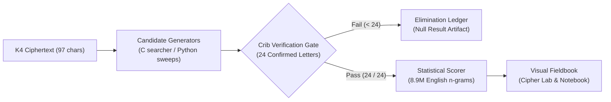

# Kryptos K4 Cryptanalysis Suite

Kryptos is an encrypted copper sculpture dedicated in 1990 at CIA Headquarters in Langley, Virginia. While its first three passages (K1–K3) were solved within a decade using classical ciphers, its final 97-character section (**K4**) has defied cryptanalysts worldwide for over 35 years. 

This repository provides an open-source, reproducible cryptanalysis framework combining native C search engines, an 8.9M-ngram statistical evaluation suite, and an interactive browser dashboard to systematically test and eliminate K4 cipher hypotheses.

```text
OBKRUOXOGHULBSOLIFBBWFLRVQQPRNGKSSOTWTQSJQSSEKZZWATJKLUDIAWINFBNYPVTTMZFPKWGDKZXTJCDIGKUHUAUEKCAR
                      ▲            ▲                               ▲         ▲
                      └── CRIB 1 ──┘                               └── CRIB 2┘
               Pos 22-34: EASTNORTHEAST                       Pos 64-74: BERLINCLOCK
```

---

## The Cryptographic Challenge

Why has a 97-letter message resisted modern computers for decades?

Single-layer classical ciphers are easily broken by frequency analysis. In English, letters like **E** and **T** appear far more often than **Q** or **Z**. A simple substitution cipher shifts the letters, but the underlying frequency peaks remain visible.

To measure this, cryptographers calculate the **Index of Coincidence (IC)**: a statistical score measuring how unevenly letter frequencies are distributed.
- Natural English has an IC around **0.067** (peaked and uneven).
- Random alphabetical noise has an IC around **0.038** (completely flat).
- **K4's raw IC is 0.0361.**

A score of 0.0361 proves that K4 cannot be a simple substitution or a pure transposition of English. Furthermore, 97 is a prime number, meaning the text cannot be neatly arranged into a rectangular grid without nulls, incomplete rows, or masking.

### A 10-Letter Toy Example: The Two-Layer Barrier

To see why single-step attacks fail, consider encrypting the 10-letter message `ATTACKEAST`:

1. **Step 1 (Transposition):** Scramble letter positions by writing into a $2 \times 5$ grid and reading down columns:
   ```text
   A T T A C
   K E A S T   ──> Read columns: AK TE TA AS CT  ──> "AKTETAASCT"
   ```
2. **Step 2 (Substitution):** Shift each letter using a repeating keyword like `KEY`:
   ```text
   Text: AKTETAASCT
   Key:  KEYKEYKEYK
   Out:  KOFDCKKYMZ
   ```

If you attempt frequency analysis on `KOFDCKKYMZ`, the substitution flattens letter counts. If you try to guess keyword shifts, the letters are in the wrong positions. You cannot solve one layer without first untangling the other. K4 uses a similar multi-layered design.

---

## Known Clues: Ground-Truth Cribs

Between 2010 and 2020, sculptor Jim Sanborn publicly revealed **24 confirmed plaintext letters**:

| Anchor | 1-Based Span | Length | Ciphertext Segment | Plaintext Reveal | Context |
|---|---|---|---|---|---|
| **Crib 1** | Positions 22–34 | 13 letters | `FLRVQQPRNGKSS` | `EASTNORTHEAST` | Compass heading (Sanborn, 2020) |
| **Crib 2** | Positions 64–74 | 11 letters | `NYPVTTMZFPK` | `BERLINCLOCK` | Alexanderplatz World Clock (Sanborn, 2010/14) |

A **crib** is a known piece of plaintext suspected or confirmed to exist at a specific position. These 24 characters serve as a strict validation gate. If a candidate decryption fails to match all 24 characters exactly, it is discarded immediately.

---

## Architecture & Pipeline



1. **Native C Engines:** Execute billions of permutation sweeps per second across columnar, route, and matrix spaces.
2. **Crib Gate:** Instantly eliminates candidates that fail to reproduce the 24 confirmed letters.
3. **Statistical Scorer (`english_z`):** Evaluates surviving text against an 8.9-million letter English n-gram model ($z < 0.20$ is noise; $z \ge 0.80$ indicates natural English syntax).
4. **Visual Fieldbook:** An interactive browser lab for real-time matrix transformations, route inspection, and ledger auditing.

---

## What We Tested & Current Findings

**K4's cryptographic cipher has not been solved.**

In late 2025, researchers Jarett Kobek and Richard Byrne located Sanborn's original 1990 plaintext working drafts in the Smithsonian archives (confirmed by Sanborn, with validation hosted by Paradigm). However, the mathematical method, encryption keys, and transposition algorithm remain unpublished and unsolved.

This repository systematically tests and bounds the remaining cipher space:

| Attack Vector | Search Space Tested | Result | Cryptanalytic Finding |
|---|---|---|---|
| **Columnar Transposition** | Widths 2–14 (all $W!$ orders) $\times$ periodic keys | Eliminated | Pure columnar transposition paired with periodic keys is ruled out. |
| **Wide Columnar** | Widths 15–26 guided by 535 city keyword orders | Eliminated | 353,100 specific geographic column orders rejected. |
| **Hill Cipher** | $2 \times 2$ and $3 \times 3$ linear matrix transforms | Eliminated | Linear modular matrix multiplication alone cannot produce K4. |
| **World Clock Keystreams** | 28,632 cylinder rotations and city-letter streams | Eliminated | Direct polyalphabetic substitution from 97 DDR city names fails holdouts. |
| **Morse Code Masks** | 37,164 binary modulation masks from courtyard slabs | Statistically Bounded | Weak signal with `PALIMPSEST` ($z = 0.1097$), but insufficient on holdouts. |
| **Paper-Strip Permutations** | 26,040 clause and strip reorderings around `X` delimiters | Bounded | Direct reassembly of ciphertext slices requires an earlier transposition layer. |

---

## Installation & Requirements

- **Operating System:** macOS or Linux
- **Prerequisites:** Python 3.10+, GCC or Clang, Node.js 18+ (for dashboard)

```bash
# Clone the repository
git clone https://github.com/JSK-85/K4.git
cd K4

# Build native C binaries
gcc -O3 -march=native src/search.c -o bin/search
gcc -O3 -march=native src/hillvig.c -o bin/hillvig

# Install Python dependencies
python3 -m pip install -r requirements.txt
```

---

## How to Run

### 1. Check Project Status
```bash
python3 k4.py status
```

### 2. Launch the Interactive Dashboard
Launch the visual Cipher Lab and Experiment Notebook at `http://127.0.0.1:5173`:
```bash
python3 k4.py dashboard --fieldbook
```

### 3. Run Cryptanalytic Sweeps
```bash
# Run native C multicore brute force sweeps
python3 run_all.py

# Run targeted frontier attack suites
python3 src/attack1_world_clock_97.py       # 97-city cylinder streams
python3 src/attack2_paper_strips.py         # 6-clause paper strip permutations
python3 src/attack3_morse_masks.py          # Courtyard Morse binary masks
python3 src/attack5_linguistic_reconstruct.py # Plaintext reconstruction & SHA-256
```

### 4. Score Any Candidate String
Test any 97-character candidate against both the 24 crib positions and the 8.9M n-gram model:
```bash
python3 k4.py score "YOUR_97_CHARACTER_PLAINTEXT_HERE"
```

Example output:
```text
--- Cryptanalytic Scoring for candidate (length 97) ---
Crib Matches: 24 / 24 (100.0%)
  Crib 1 (EASTNORTHEAST @ 22-34): 13/13
  Crib 2 (BERLINCLOCK   @ 64-74): 11/11
English z-score: 1.1229
Interpretation: Plausible English structure (natural prose).
```

---

## Project Structure

```text
K4/
├── k4.py                           # Master CLI orchestrator
├── run_all.py                      # Multicore attack runner
├── k4.txt                          # Canonical ciphertext and crib anchors
├── fieldbook_experiments.json      # 107 schema-validated candidate experiments
├── requirements.txt                # Python runtime dependencies
├── bin/
│   ├── search                      # Compiled C columnar/route search engine
│   └── hillvig                     # Compiled C Hill matrix search engine
├── src/
│   ├── bridge.py                   # Scoring bridge and JSON export utilities
│   ├── attack1_world_clock_97.py   # World clock 97-city keystream runner
│   ├── attack2_paper_strips.py     # Paper strip permutation solver
│   ├── attack3_morse_masks.py      # Morse code binary mask suite
│   ├── attack4_cardan_grille.py    # 4-turn Cardan Grille aperture tests
│   └── attack5_linguistic_reconstruct.py # Linguistic candidate generator
└── external/                       # Integrated cryptanalysis research modules and visual lab
```

---

## Limitations & Next Ideas

- **Irregular / Disrupted Transposition:** Sanborn likely cut paper strips or varied column depths by keyword rank rather than adhering to rigid matrices. Irregular grid searchers represent the most promising open frontier.
- **Physical Stencils:** Testing physical Cardan grilles with cutouts matching courtyard Morse rhythms or sculpture hole patterns.
- **Two-Step Integration:** Combining non-standard transposition unravelling with inverse `KRYPTOS`-alphabet Vigenère substitution.

---

## Mini-Glossary

- **Vigenère Cipher:** A substitution cipher shifting each letter by an amount defined by a repeating keyword—like rotating through multiple Caesar ciphers.
- **Keyed Alphabet:** An alphabet rearranged to begin with a keyword before listing remaining unused letters in order (e.g. `KRYPTOSABCDEFGHIJLMNQUVWXZ`).
- **Transposition:** Rearranging the order of letters without altering their identities—a structured anagram.
- **Crib:** A known or confirmed segment of plaintext used as a benchmark to test candidate decryptions.
- **Index of Coincidence (IC):** A statistical metric measuring letter frequency variance (English $\approx 0.067$, random noise $\approx 0.038$).

---

## References

1. **Jim Sanborn & Ed Scheidt:** Public announcements and cryptographic design interviews (1990–2020).
2. **K1–K3 Solutions:** Solved by Jim Gillogly, David Stein, and Smale/Bauer (1999).
3. **Smithsonian Archives of American Art:** Jim Sanborn papers (unsealed discovery by J. Kobek & R. Byrne, Sept 2025).
4. **Project Kryptos Verification:** Zero-knowledge SHA-256 HMAC verifier hosted by Paradigm (2025–2026).
