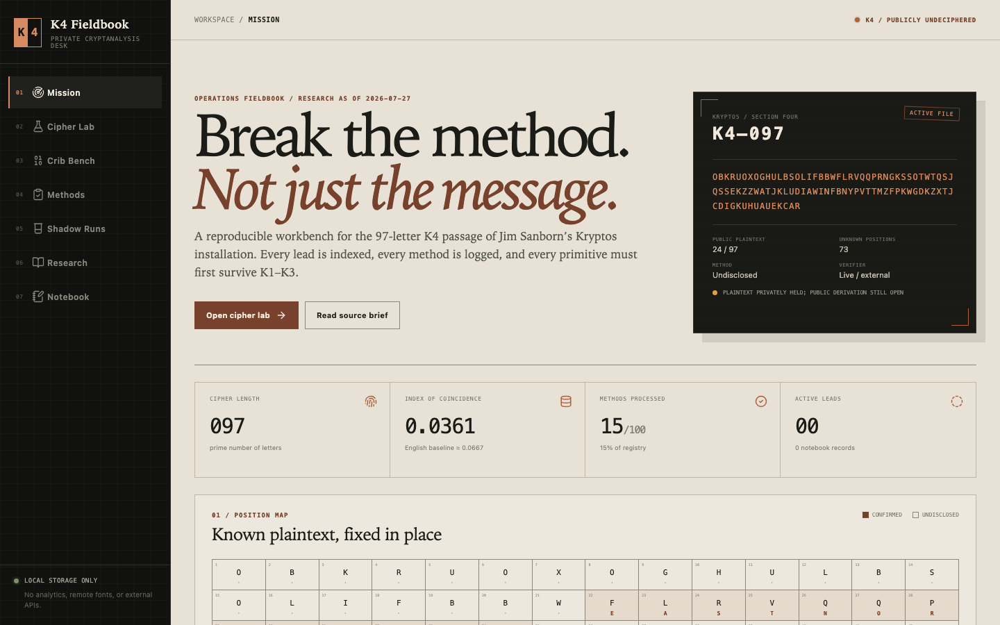

<div align="center">

# K4 Fieldbook

**A local-first cryptanalysis dashboard for Kryptos K4**

[Open the live dashboard](https://rayborg.github.io/kryptos-k4-dashboard/) · [Read the research dossier](docs/RESEARCH.md) · [Review the methodology](docs/METHODOLOGY.md)

[](https://github.com/rayborg/kryptos-k4-dashboard/actions/workflows/deploy-pages.yml)
[](#verification)
[](#privacy-boundary)
[](LICENSE)

</div>



> **The dashboard is public. Your work is not.** Technique status, notes, cribs, and experiment records stay in your browser unless you explicitly export them.

## What This Is

K4 Fieldbook turns the final public passage of Jim Sanborn's Kryptos sculpture into an auditable research workspace. It combines exact source control, classical cipher tools, fixed-position crib analysis, statistical diagnostics, a 100-method research register, and executable K1-K3 controls in one browser application.

It is built for disciplined exploration rather than one-click solution claims:

- every public K4 plaintext character is locked to its canonical one-based position
- every logged experiment records its input, output, parameters, environment, and provenance
- every cipher primitive must survive known-answer tests against K1-K3
- every serious K4 hypothesis should train on one crib block and hold out the other
- every factual claim in the research view is linked to a source tier

## K4 Status

K4 should not be described simply as solved or unsolved.

The 97-letter plaintext was reconstructed from Jim Sanborn's Smithsonian papers in September 2025 and confirmed by Sanborn, but it has not been published. No public derivation, key, or encryption method currently reproduces that plaintext from the ciphertext. Paradigm, which acquired Sanborn's private archive in November 2025, also continues to call K4 unsolved.

This project therefore uses:

> **Plaintext privately recovered and confirmed by Sanborn; method publicly undeciphered.**

The two public plaintext blocks remain:

```text
K4 positions 22-34  EASTNORTHEAST
K4 positions 64-74  BERLINCLOCK
```

## Explore The Workspace

| Workspace | Purpose |
|---|---|
| **Mission** | Current K4 status, indexed position map, corpus controls, and verified developments |
| **Cipher Lab** | Vigenere variants, Kryptos keyed alphabet, Caesar, Atbash, rail fence, columnar and route transpositions, plus live diagnostics |
| **Crib Bench** | All 97 fixed positions, public cribs, implied keystreams, conflict detection, and holdout protocol |
| **Methods** | Persistent checklist of 100 cipher families, physical hypotheses, diagnostics, and search strategies |
| **Shadow Runs** | Exact K1, physical/corrected K2, and K3 known-answer controls |
| **Research** | Evidence brief, source-tiered chronology, contradictions, open questions, and public references |
| **Notebook** | Schema-validated experiment ledger with reproducible JSON import/export |

## Privacy Boundary

The hosted dashboard has no account system and no research backend.

- No analytics, telemetry, crash reporting, remote fonts, CDN scripts, or solver APIs
- Technique status, notes, and experiments are stored in browser `localStorage`
- Multiple tabs reconcile local changes through browser storage events
- JSON is downloaded only when you choose **Export JSON**
- Common export names plus `private/`, `.private/`, and `exports/` are ignored by Git
- The public repository contains the application and public-source corpus, not personal experiment records

Browser storage is **not encrypted at rest**. Anyone with access to your browser profile, extensions, unlocked machine, or local backups may be able to read it. Protect exported notebooks accordingly.

## Run Locally

Requirements: Node.js 20 or newer.

```bash
git clone https://github.com/rayborg/kryptos-k4-dashboard.git
cd kryptos-k4-dashboard
npm install
npm run dev
```

Open `http://127.0.0.1:5173`. Vite is intentionally bound to localhost rather than the local network.

## Shadow Validation

The workbench proves its primitives against solved Kryptos passages before applying them to K4.

| Control | Parameters | Expected result |
|---|---|---|
| K1 decrypt | Key `PALIMPSEST`, keyed alphabet `KRYPTOSABCDEFGHIJLMNQUVWXZ` | Exact 63-letter plaintext, including `IQLUSION` |
| K2 physical | Key `ABSCISSA`, 369 physical letters | Exact accidental ending `IDBYROWS` |
| K2 corrected | Virtual ciphertext `S` restored near the end | Exact intended ending `XLAYERTWO` |
| K3 decrypt | Inverse `24 x 14`, then inverse `8 x 42` route | Exact 336-letter plaintext |
| K3 re-encrypt | `8 x 42`, then `24 x 14` rotational route | Exact canonical ciphertext |

## Verification

```bash
npm test           # 37 deterministic unit tests
npm run test:e2e   # 9 Chrome browser tests
npm run typecheck
npm run build
```

Coverage includes canonical section lengths, all public K4 indices, K1-K3 exact answers, cipher round trips, statistical fixtures, malformed-storage recovery, schema rejection, mobile behavior, experiment persistence, and cross-tab synchronization.

## Research Standard

A credible K4 candidate should:

1. produce a coherent full plaintext, not selected words
2. match all 24 public positions exactly
3. use one explicit rule without local patches
4. disclose alphabets, keys, routes, padding, offsets, search space, score, and seed
5. survive an independent implementation and matched random controls
6. pass the current owner-operated verifier

The complete operational protocol is in [`docs/METHODOLOGY.md`](docs/METHODOLOGY.md). The cited historical and technical record, current through July 27, 2026, is in [`docs/RESEARCH.md`](docs/RESEARCH.md).

## Contributing

Issues and pull requests are welcome for:

- independently sourced corrections to the public record
- additional bounded, invertible cipher primitives
- stronger statistical controls and reproducibility metadata
- accessibility and browser-compatibility improvements
- new K1-K3 regression fixtures

Do not submit private K4 plaintext claims, leaked archival material, personal notebook exports, or unverifiable "solutions." A proposed method should include exact parameters, complete output, and a falsifiable test.

## Rights And License

The dashboard source code is available under the [MIT License](LICENSE).

Kryptos, its artistic text, and its imagery remain copyrighted by Jim Sanborn. This repository does not redistribute sculpture photographs or archival images. Citations and cryptographic test vectors are included for research, interoperability, and verification.

This is an independent research project. It is not affiliated with Jim Sanborn, the CIA, Smithsonian Institution, Paradigm, or RR Auction.
